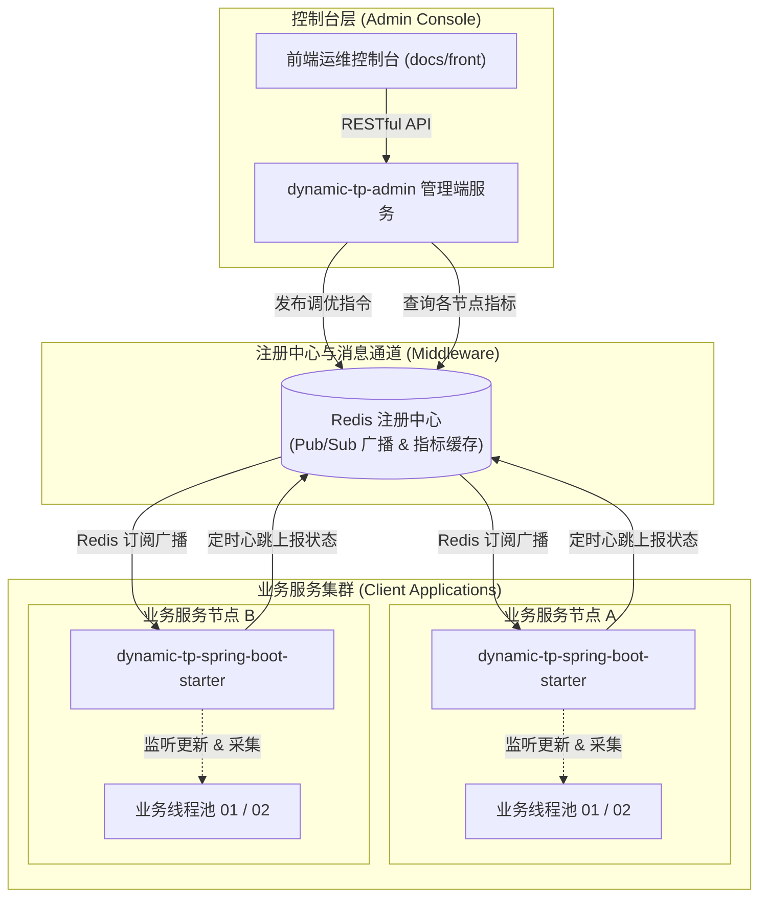
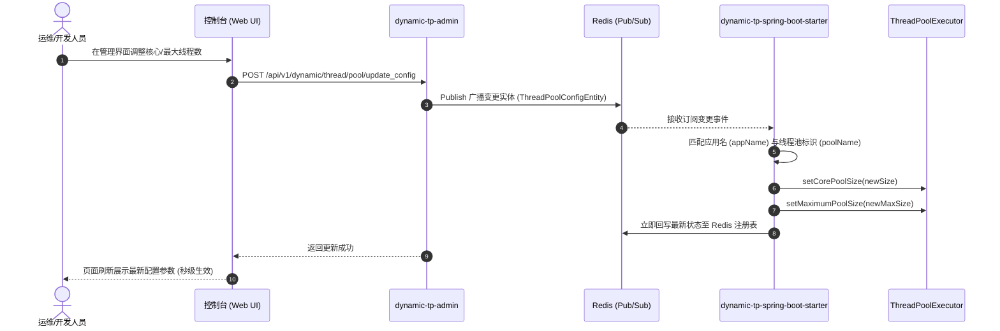

# 🚀 dynamic-tp-spring-boot-starter

<p align="center">
  
  
  
  
</p>

> **轻量级、无侵入、高可靠的分布式动态可监控线程池组件。**  
> 致力于解决微服务架构下线程池“参数静态固化、运行状态黑盒、故障无法快速干预”的核心痛点。

---

## 📌 为什么需要动态线程池？

在传统的 Java 业务开发中，`ThreadPoolExecutor` 的核心参数（如核心线程数、最大线程数、队列容量）往往硬编码或配置在静态配置文件中：

1. **参数调优成本极高**：大促突发流量或线上线程池堆积时，必须修改配置并**重启服务**才能生效，面临短暂服务中断与流量跌损风险。
2. **运行状态形同黑盒**：无法实时获知各业务线程池的核心使用率、队列排队积压情况、拒绝策略触发频率。
3. **容量预估存在偏差**：线下压测配置的线程参数在面对线上真实流量倾斜时难以契合，参数设置过小导致排队超时拒绝，设置过大导致频繁上下文切换甚至 OOM。

**dynamic-tp-spring-boot-starter** 提供了开箱即用的解决方案：
* **零侵入接管**：无缝扫描并管理 Spring 上下文中的标准线程池 Bean。
* **参数秒级热刷新**：基于 Redis 高性能 Pub/Sub 机制，毫秒级跨集群同步更新核心线程与最大线程数。
* **动态指标上报**：内置轻量周期上报任务，实时采集线程池活跃度、队列积压状态，集中展示与治理。

---

## 🏗️ 系统架构设计

### 1. 架构总览



---

### 2. 动态调参时序图



---

## 📦 模块规划

```text
dynamic-tp-spring-boot-starter
├── dynamic-tp-spring-boot-starter  # [核心 SDK] 自动装配、动态调参监听、定时数据上报
├── dynamic-tp-admin                # [管理服务] 线程池集群配置查询、参数推送控制端
├── dynamic-tp-test                 # [测试演练] 业务接入与调优验证示例工程
└── docs                            # 部署脚本与前端管理单页 (Docker-Compose / HTML)
```

---

## ⚡ 快速接入指南

### 第一步：引入 Starter 依赖

在你的 Spring Boot 业务项目中引入依赖：

```xml
<dependency>
    <groupId>com.ran.middleware</groupId>
    <artifactId>dynamic-tp-spring-boot-starter</artifactId>
    <version>1.0.0</version>
</dependency>
```

### 第二步：添加配置项

在业务工程的 `application.yml` 中添加配置：

```yaml
dynamic:
  thread:
    pool:
      config:
        enabled: true           # 是否启用动态线程池管理
        host: 127.0.0.1         # Redis 地址
        port: 6379              # Redis 端口
        password:               # Redis 密码 (若无则留空)
        pool-size: 10           # Redisson 最小连接池
        min-idle-size: 5        # Redisson 最小空闲连接数
        idle-timeout: 30000     # 空闲超时时间 (ms)
        connect-timeout: 5000   # 连接超时 (ms)
        retry-attempts: 3       # 重试次数
        retry-interval: 1000    # 重试间隔 (ms)
```

### 第三步：定义普通线程池 Bean

无需改动既有业务代码，直接注入标准的 `ThreadPoolExecutor`：

```java
@Configuration
public class ThreadPoolConfig {

    @Bean("orderThreadPoolExecutor")
    public ThreadPoolExecutor orderThreadPoolExecutor() {
        return new ThreadPoolExecutor(
                10,
                20,
                10,
                TimeUnit.SECONDS,
                new LinkedBlockingQueue<>(1000),
                new ThreadFactoryBuilder().setNameFormat("order-tp-%d").build(),
                new ThreadPoolExecutor.CallerRunsPolicy()
        );
    }
}
```

> **提示**：Starter 会在 Spring 容器启动完成后自动扫描并纳入动态纳管，定时向 Redis 上报核心线程数、最大线程数、队列长度及拒绝策略。

---

## 🖥️ 运维管理与控制台

### 启动 Admin 服务
进入 `dynamic-tp-admin` 模块，配置对应的 Redis 连接后启动应用（默认端口 `8089`）。

### API 接口说明
* **查询线程池配置列表**：
  ```http
  GET /api/v1/dynamic/thread/pool/query_thread_pool_list
  ```
* **动态更新线程池参数**：
  ```http
  POST /api/v1/dynamic/thread/pool/update_thread_pool_config
  Content-Type: application/json

  {
    "appName": "dynamic-thread-pool-test-app",
    "threadPoolName": "orderThreadPoolExecutor",
    "corePoolSize": 25,
    "maximumPoolSize": 50
  }
  ```

---

## 📋 配置参数说明

| 配置键 | 类型 | 默认值 | 说明 |
| :--- | :---: | :---: | :--- |
| `dynamic.thread.pool.config.enabled` | Boolean | `false` | 是否开启动态线程池治理 SDK |
| `dynamic.thread.pool.config.host` | String | `127.0.0.1` | Redis 连接 Host 地址 |
| `dynamic.thread.pool.config.port` | Integer | `6379` | Redis 端口 |
| `dynamic.thread.pool.config.pool-size` | Integer | `10` | Redisson 连接池大小 |
| `dynamic.thread.pool.config.min-idle-size` | Integer | `5` | Redisson 连接池最小空闲连接数 |

---

## 🤝 贡献与反馈

欢迎提交 Issue 和 Pull Request，共同完善动态线程池生态！

1. Fork 本仓库并创建特性分支 (`git checkout -b feature/AmazingFeature`)
2. 提交代码更改 (`git commit -m 'feat: Add some AmazingFeature'`)
3. 推送至远程分支 (`git push origin feature/AmazingFeature`)
4. 发起 Pull Request

---

## 📄 License

本项目基于 [Apache License 2.0](LICENSE) 开源。
